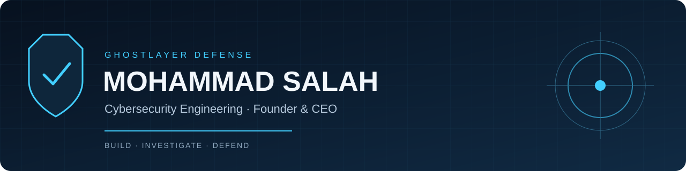

<h1 align="center">Mohammad Salah</h1>

<strong>Cybersecurity Engineering Student · Founder & CEO, GhostLayer Defense</strong>

Building practical tools to make security evidence easier to inspect and act on.

<a href="https://ghostlayerdefense.com">GhostLayer Defense</a> · <a href="mailto:info@ghostlayerdefense.com">Business contact</a>

## About me

I’m a cybersecurity engineering student building GhostLayer Defense. My interest in security began at 14, after a compromised download led me to ask how the attack worked. Today, I’m turning that curiosity into documented tools and reproducible defensive labs.

My current focus is authentication-event analysis, file integrity, web security controls, and clear technical reporting. This portfolio shows what each project does, how to reproduce its results, and where its limits are.

## Engineering portfolio

| Project | Purpose | Evidence |
| --- | --- | --- |
| [**GhostLayer AuthWatch**](https://github.com/Moesalah12/ghostlayer-authwatch) | Triage normalized authentication events using sliding windows | Synthetic dataset, JSON alerts, threshold and correlation tests |
| [**GhostLayer Integrity**](https://github.com/Moesalah12/ghostlayer-integrity) | Compare directory contents against SHA-256 baselines | Added/removed/modified reports and filesystem tests |
| [**GhostLayer HeaderCheck**](https://github.com/Moesalah12/ghostlayer-headercheck) | Review saved HTTP headers or one authorized response | Weak/hardened fixtures, offline reports, redirect boundary test |
| [**GhostLayer Security Labs**](https://github.com/Moesalah12/ghostlayer-security-labs) | Reproduce a small defensive investigation | Commands, expected results, and a scoped incident report |

Each project includes reproducible examples and documented limitations.

## How I approach security

- Work within an explicit scope and protect sensitive evidence.
- Make results reproducible with synthetic examples and tests.
- Explain uncertainty, false positives, and remediation choices.
- Use automation to support investigation and human judgment.

## GhostLayer Defense

I’m building GhostLayer Defense around practical cybersecurity engineering and clear communication. These open-source projects are educational portfolio work; they do not imply customer deployments or independent security audits.

**Interested in a project or collaboration?** Reach me at [info@ghostlayerdefense.com](mailto:info@ghostlayerdefense.com).

Project code and documentation are developed with AI assistance. Each repository records its scope, validation, and limitations.
